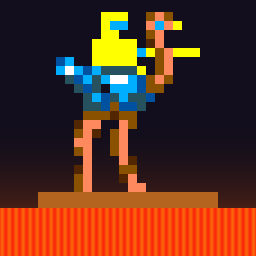

# JoustX



A C# port of Williams' 1982 **Joust** that keeps the original game mechanics exactly, with a path to modern (2026) graphics and sound.

The approach is a *verified port*: the original 6809 program, assembled from source, runs on a C# reference machine. That machine is the ground truth that the native C# rewrite is checked against, routine by routine. See [docs/ROADMAP.md](docs/ROADMAP.md).

The game now runs entirely in C#, with no CPU emulation on either board: the main board's 6809 and the sound board's 6808. The hot paths are hand-written; the rest is translated from the original source by `joust-tools translate`. It stays identical to the original frame by frame. See [docs/NO-CPU-PLAN.md](docs/NO-CPU-PLAN.md).

## Layout

| Project | What it is |
| --- | --- |
| `joust-main-asm/` | Original source (SynaMax's rewrite for Macro Assembler {AS}), untouched |
| `src/Joust.Assembler` | C# 6809 assembler for the AS dialect. Builds the 12 main-board ROMs from source |
| `src/Joust.Emulation` | 6809 CPU, SC1 blitter, 6821 PIAs, CMOS, video timing (the reference machine), plus `GameStateReader` |
| `src/Joust.Port` | The native C# port: hand-written routines, the translated program (`Translated/`) and the no-CPU runtime, all verified against the original |
| `src/Joust.Host` | One running game with no window, audio device or file system (`JoustSession`): the CPU mode, first-launch factory settings, the frame loop, the audio mix and both pictures; `GameImage` assembles the program or loads a saved image. Every front end builds on it |
| `src/Joust.Web` | The browser version: the game compiled to WebAssembly, and a small WebGL2 / Web Audio page (`wwwroot`); built and served by `docker/web` |
| `src/Joust.App` | MonoGame window around a `JoustSession`: plays the game (in C# with no CPU; `--cpu` keeps the emulated 6809 behind the C# code, `--original` runs pure emulation), keyboard input, CMOS persistence |
| `src/Joust.Tools` | CLI: `build-roms`, headless `run` with screenshots and scripted input, `verify-native`, `translate`, `bench`, `census` |
| `tests/Joust.Tests` | Assembler encodings, CPU semantics, ROM checksums, golden replay |

## Run it

Requires the .NET 10 SDK.

```bash
dotnet run --project src/Joust.App
```

The app assembles the game from `joust-main-asm/` at startup and refuses to run unless all 12 ROMs match the original ROM-test checksums. With blank CMOS, the first launch restores factory settings behind the scenes and power-cycles, so it boots straight to attract mode. CMOS is saved to `%LOCALAPPDATA%\JoustX\cmos.bin`.

| Key | Action |
| --- | --- |
| `5` / `6` | Insert coin (left / right) |
| `1` / `2` | 1 or 2 player start |
| Left / Right or A / D, Space | Player 1 move, flap |
| J / L, K | Player 2 move, flap |
| F1 | Toggle object overlay (from `GameStateReader`) |
| F2 | Service "advance" switch |
| F3 | Reset |
| F5 / F6 / F7 / F8 | HD or classic graphics / CRT effect / reverb / widescreen (remembered between runs) |
| F9 | HD drawn on the GPU (normal) or by the CPU renderer, for comparison |
| F11 or Alt+Enter | Fullscreen (remembered between runs) |
| Alt+1 … Alt+9 | Same as F1 … F9, for keyboards whose top row sends media keys |
| Esc | Quit |

Xbox (XInput) pads 1 and 2 play players 1 and 2: D-pad or left stick to steer, A/B/X to flap, Start to start, Back to insert a coin. `--classic` starts with the original graphics.

The HD picture is drawn on the GPU by shaders (`src/Joust.App/Shaders/Hd.fx`), about 1.4 ms a frame; the CPU renderer in `Joust.Render` stays as the reference, and `--cpu-render` (or F9) uses it. `--compare-render <dir>` draws a few frames both ways and writes the pictures, their difference and a report. The build recompiles the shaders when `Hd.fx` changes, with the repository's shader compiler (run `dotnet tool restore` once); without it the checked-in `Hd.mgfxo` is used.

## Play it in a browser

```bash
powershell -File scripts/web-docker.ps1
```

This builds the browser version in Docker and serves it at http://127.0.0.1:8080 and over HTTPS at https://127.0.0.1:8443 (a self-signed certificate: the browser warns once). `-Port` and `-HttpsPort` pick other ports, and `-Stop` stops it. If a gamepad does nothing, `/pads.html` lists what the browser reports, as does F10 in the game. On one machine Chrome showed no gamepad to any page until the experimental `chrome://flags` setting "Gamepad Multitouch" was set to Disabled. The first build downloads the .NET WebAssembly tools and takes several minutes. The game (`Joust.Host`, both boards in C#) is compiled ahead of time to WebAssembly (`src/Joust.Web`). A small page draws it with WebGL2 (`wwwroot/gl.js`, a GLSL port of `Hd.fx`), plays its sound through Web Audio and reads the keyboard and gamepads. The keys are as on the desktop. The saved settings stay in the browser. The game image is assembled from `joust-main-asm/` during the build (`joust-tools build-image`). Keep it to your own machine: the game's code and art belong to their owners.

## Tools

```bash
dotnet run --project src/Joust.Tools -- build-roms joust-main-asm/make.ASM build/roms
dotnet run --project src/Joust.Tools -- run build/roms/joust_main_64k.bin 2200 build/play --cmos build/cmos.bin --shots 2000 --script "1200:coin 1300:start1"
```

```bash
dotnet run --project src/Joust.Tools -- verify-native --frames 20000 --seeds 1,2,3
```

`verify-native` plays deterministic pseudo-random games and checks every native routine against the original two ways. Per call, it runs both versions from the same state and compares registers, flags, cycles and memory writes. In lockstep, it runs an all-original machine and a native machine side by side and compares them every frame. `--no-cpu` runs the lockstep machine with no CPU emulation; `--translated-only` checks the translated program without the hand-written routines.

```bash
dotnet run --project src/Joust.Tools -- translate
```

`translate` regenerates `src/Joust.Port/Translated/*.g.cs` (the main program, and the sound board's program in `Sound.g.cs`) from the original source. The translation checks at start-up that the ROM is the one it was made from. `bench` compares the speed of the original, of C# with the CPU behind it, and of C# with no CPU.

`build-roms` writes the 12 ROM files (MAME names), a 64K image and a symbol file, then checks every ROM against the game's own checksum table. `run` emulates headlessly (about 4,000 fps), saves PNG screenshots and lists live objects. `--watch C000-C00F` traces writes to an address range.

## Tests

```bash
dotnet test
```

If Windows Smart App Control blocks the freshly built test assembly ("An Application Control policy has blocked this file"), run the suite in a Linux container instead (needs Docker Desktop):

```bash
powershell -File scripts/test-docker.ps1
```
